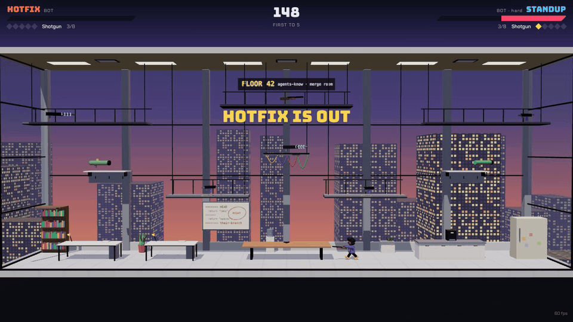

<div align="center">

# Merge Conflict

### Some conflicts can't be resolved in code.

**A studio of fast browser games for settling it with your coworkers.**<br>
Pick a game, send your rival a link, settle it. No installs, no accounts.

### [▶ merge-conflict-drab.vercel.app](https://merge-conflict-drab.vercel.app)



</div>

## Games

| Game | What it is | Status |
| --- | --- | --- |
| [**Floor 42**](https://floor-42.vercel.app) ([source](https://github.com/hacagahasanli/floor-42)) | Code review got personal. Two developers, one floor of guns, and the meeting table is your only cover. Two hits and you're out. | online 1v1 |
| [**Last Commit Standing**](https://last-commit-standing.vercel.app) ([source](https://github.com/hacagahasanli/last-commit-standing)) | A battle royale for developers who never agree: ten of you parachute into the same countryside, the Deadline closes in, and only the last one standing gets to merge. | online, up to 10 |
| **Parking Lot** ([source](https://github.com/hacagahasanli/parking-lot)) | Four company cars, one free space, no insurance. Touch nothing, park first, and climb a multi-storey car park one stage at a time. | coming soon |

Every game lives in its own repo and is deployed on its own. This repo is the studio page that lists them.

## This site

Plain HTML and CSS, no build step. Open `index.html`, or serve the folder:

```bash
npx serve .
```

Live at [merge-conflict-drab.vercel.app](https://merge-conflict-drab.vercel.app) (Vercel). The `mergeconflict.gg` domain comes later.

## Support the studio

The games are free. If you want to help with servers and new games, [buy the studio a coffee](https://merge-conflict-drab.vercel.app/donate.html) (pay what you want, from $1, handled by [itch.io](https://mergeconflictgames.itch.io/support); donors get a wallpaper pack).

## Pitch a game

Have a conflict that deserves its own game? [Open an issue](https://github.com/hacagahasanli/merge-conflict/issues/new).
